<div align="center">

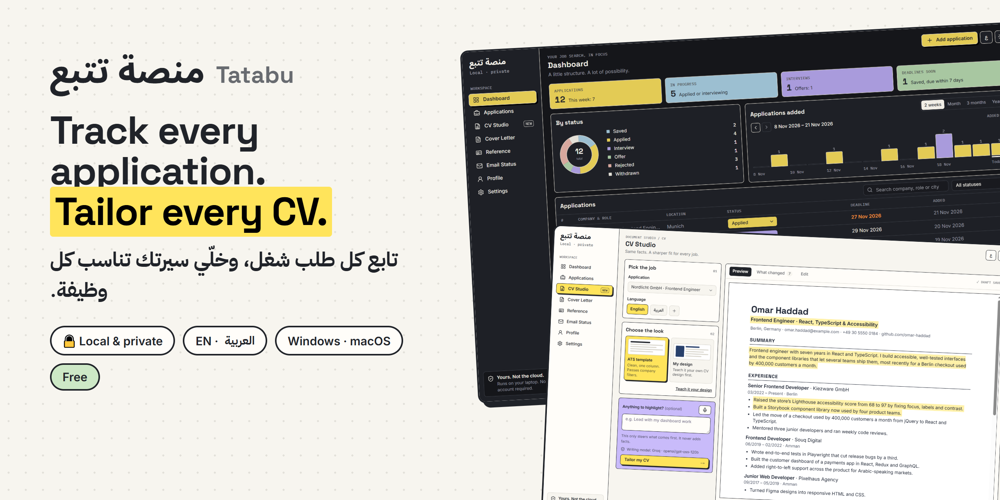

# Tatabu · منصة تتبع

**A private job-application tracker for Windows and macOS that tailors your CV and cover letter to every job, in English, Arabic or any language you add.**

**برنامج على جهازك لتتبّع طلبات الشغل، بيفصّل سيرتك الذاتية ورسالة التقديم على مقاس كل وظيفة، بالعربي والإنجليزي وبأي لغة بتضيفها.**

[](https://github.com/waeltechx/Tatabu/releases/latest)
[](https://github.com/waeltechx/Tatabu/releases)

[](LICENSE)

### [⬇ Download for Windows & macOS](https://github.com/waeltechx/Tatabu/releases/latest)

[English](#english) · [العربية](#العربية)

</div>

---

<a id="english"></a>

## Why Tatabu

- **Everything stays on your computer.** No account, no cloud, no tracking.
- **Bring your own AI key.** One free [Groq](https://console.groq.com) key runs everything (voice and text). Gemini, OpenAI, OpenRouter or any OpenAI-compatible endpoint can write the text instead.
- **Nothing is made up.** Every tailored line cites the fact in your CV it came from, and the app warns you when generated text contains something your CV doesn't say.
- **Arabic is a first-class language.** The whole app, the CVs and the letters work right-to-left, not as an afterthought.

## How it works

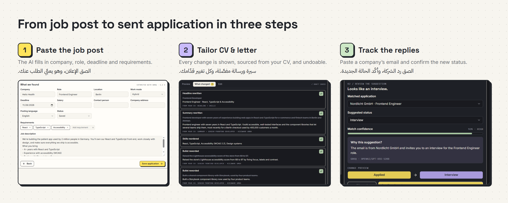

## One CV, a sharper fit for every job

Upload your CV once. For each job, Tatabu reorders your skills, rewrites your headline and summary, and picks the experience that matters, using only facts from your CV. You see every change and can switch any of them off.

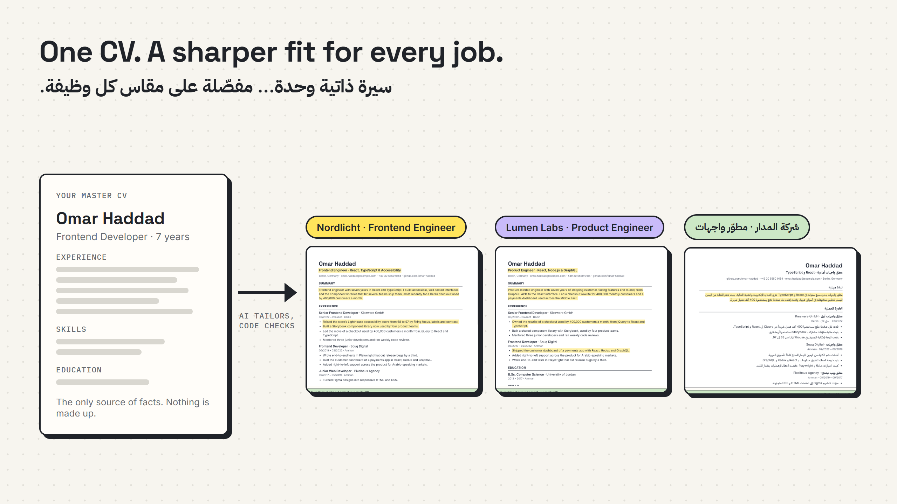

## A tour of the app

<table>
  <tr>
    <td width="50%">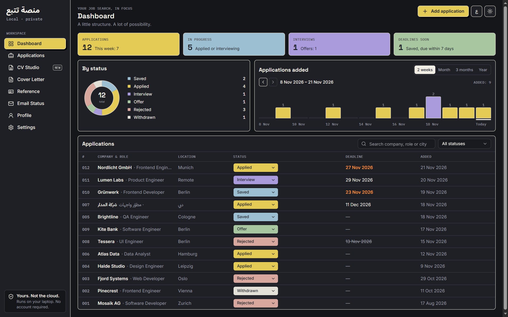<br><b>Dashboard</b>: every application, its status and the deadlines that are coming up.</td>
    <td width="50%">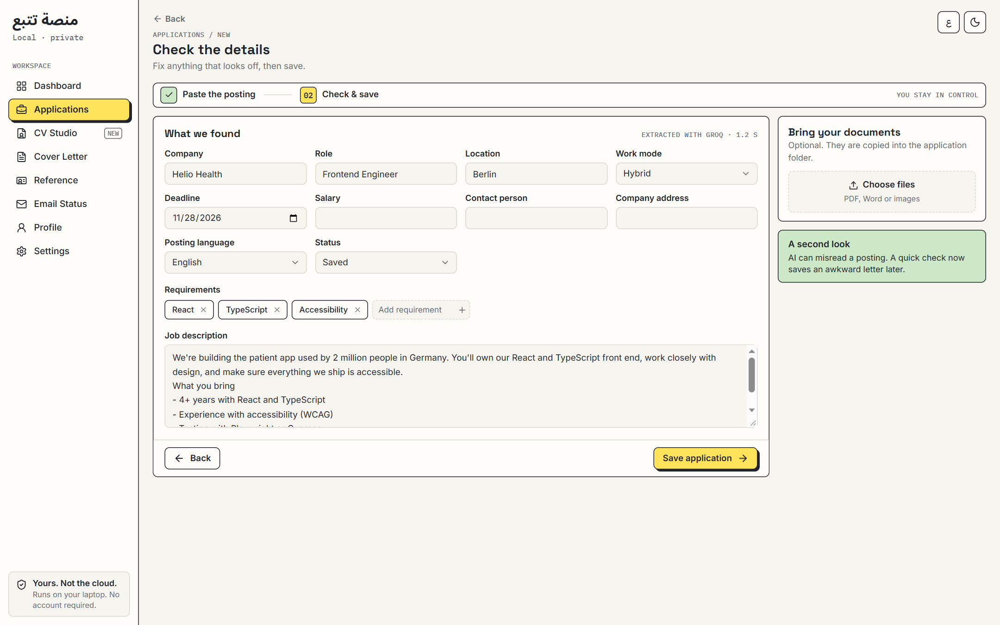<br><b>Paste a job post</b>: the app fills in the application and warns you if you already applied.</td>
  </tr>
  <tr>
    <td>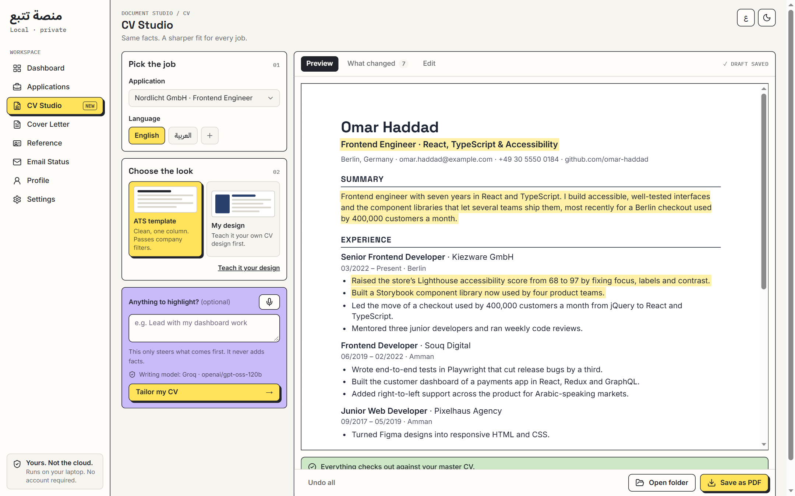<br><b>CV studio</b>: a tailored CV in a clean ATS template, or in <b>your own design</b> (upload your CV's PDF once).</td>
    <td>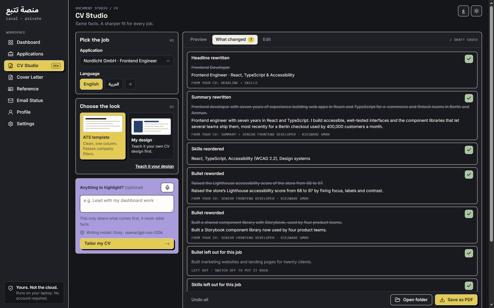<br><b>What changed</b>: every rewrite, with the line of your CV it came from. Undo any of them.</td>
  </tr>
  <tr>
    <td>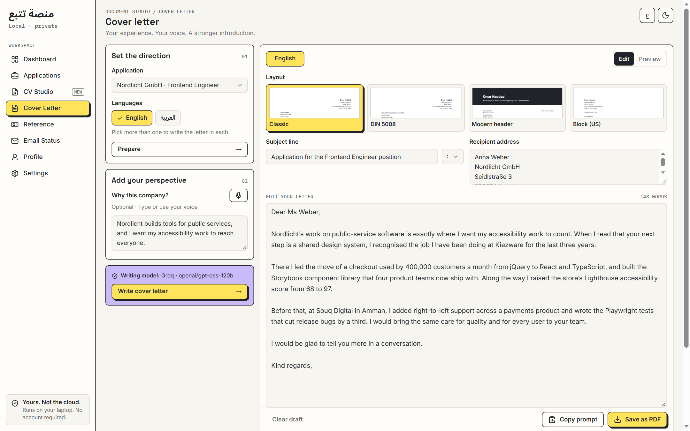<br><b>Cover letters</b> in classic, DIN 5008, modern and Arabic layouts, with your signature.</td>
    <td>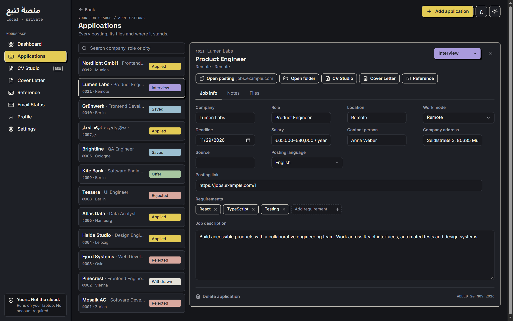<br><b>Every application in one place</b>: details, notes, files, and its own folder named after the company and job.</td>
  </tr>
  <tr>
    <td>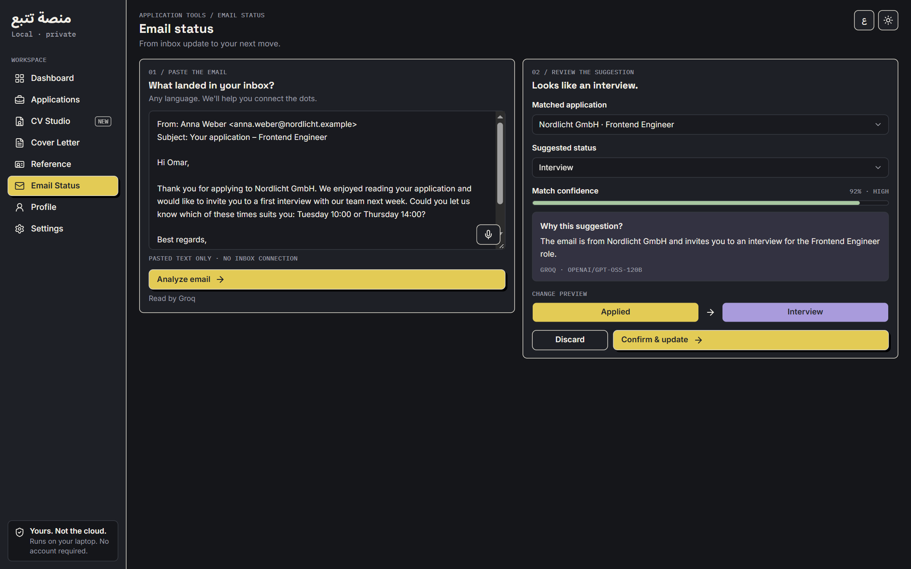<br><b>Email status</b>: paste a reply from a company and confirm the suggested new status. Nothing changes until you do.</td>
    <td>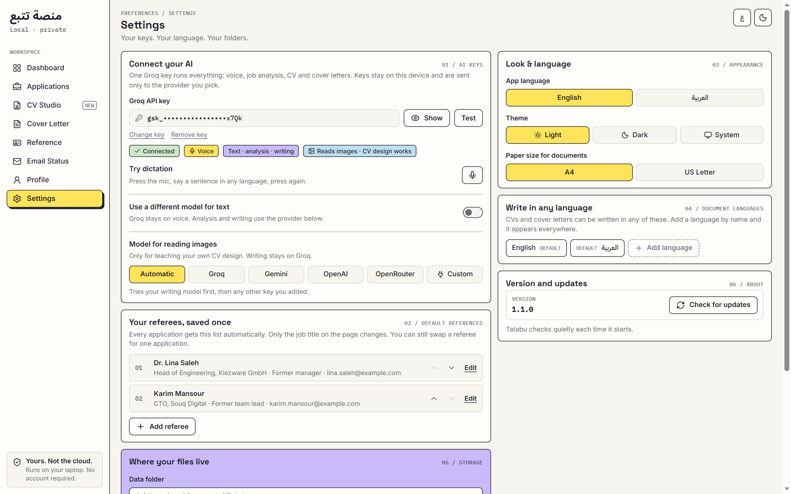<br><b>Settings</b>: your AI keys (encrypted), referees, document languages, theme and paper size.</td>
  </tr>
</table>

## Light & dark, English & العربية

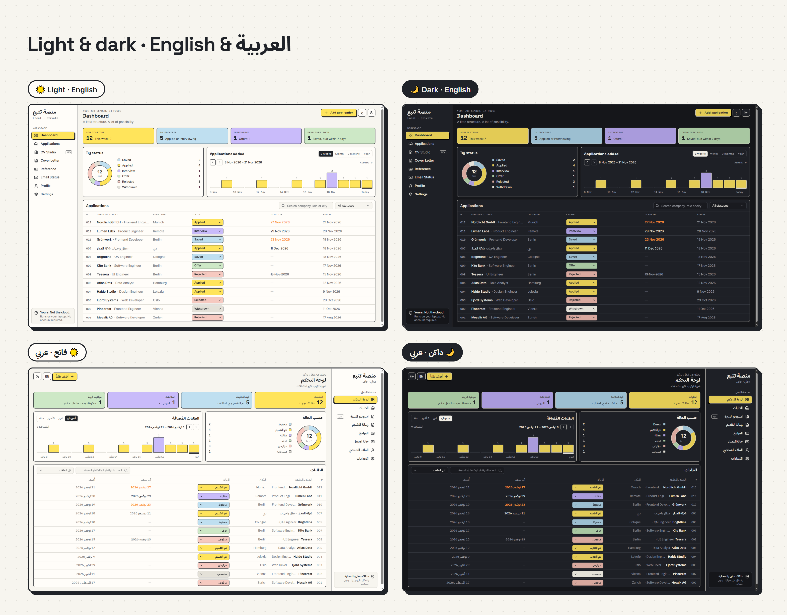

## Download

Get the latest version from the [Releases page](https://github.com/waeltechx/Tatabu/releases/latest):

| System | File |
| --- | --- |
| Windows 10 or 11 (64-bit) | `Tatabu-Setup-x.y.z.exe` |
| macOS 12 Monterey or later (Apple Silicon and Intel) | `Tatabu-x.y.z-mac.dmg` |

<details>
<summary><b>First install</b> (Windows and macOS ask you to confirm the first time)</summary>

Tatabu is free and isn't signed with a paid certificate, so Windows and macOS ask you to confirm the first time.

**Windows**

1. Run `Tatabu-Setup-x.y.z.exe`.
2. If you see **"Windows protected your PC"**, click **More info**, then **Run anyway**.
3. Follow the installer. Tatabu adds a desktop shortcut and a Start menu entry.

**macOS**

1. Open `Tatabu-x.y.z-mac.dmg` and drag **Tatabu** into **Applications**.
2. Open Tatabu from Applications. macOS says it can't check the app. Click **Done** (or **OK**).
3. Open **System Settings → Privacy & Security**, scroll down to the message about Tatabu and click **Open Anyway**. Confirm with your password.
4. From then on Tatabu opens normally. The first time you press a microphone button, macOS asks for microphone access.

</details>

<details>
<summary><b>Updates</b></summary>

Tatabu checks for a new version quietly when it starts.

- **Windows:** the update downloads in the background. A banner says when it's ready; click **Restart to update** (or it installs the next time you quit).
- **macOS:** a banner says a new version is out; click **Download** and drag the new Tatabu into Applications, replacing the old one. Your data stays.

You can also check by hand in **Settings → Version and updates**.

</details>

<details>
<summary><b>Getting a free Groq key</b></summary>

1. Go to [console.groq.com](https://console.groq.com) and sign in (Google, GitHub or email).
2. Open **API Keys** and click **Create API Key**. Give it any name.
3. Copy the key. It starts with `gsk_` and is shown only once.
4. In Tatabu, open **Settings → Connect your AI**, paste the key and click **Save**. Tatabu tests it and shows which features it can use.

Groq's free tier has rate limits. If you hit one, wait a minute and try again, or add a second provider in Settings and use **Try with …** on the error message.

</details>

## Privacy

- **Your data stays on your computer.** Applications, CVs, letters and settings are kept in a local database, and your files in a folder you choose (by default `Documents/Tatabu`). There is no Tatabu server and no account.
- **No analytics, no tracking.** Tatabu doesn't collect or send usage data.
- **What leaves your computer, and when:** only when you press a button that uses AI, the text needed for that task (a job post, your CV facts, an email you pasted, a voice recording, or images of your CV pages for "Teach your design") goes to the AI provider *you* picked, using *your* key. That provider's own privacy terms apply. Tatabu never switches providers on its own. The only other connection is the update check to GitHub.
- **Keys are encrypted** with your system's keychain (Windows DPAPI, macOS Keychain). They're never written in plain text, never logged, and never put in backups.
- **Backups** (Settings → Backup) are a normal `.zip` with your data and files, *not* encrypted. Keep them somewhere safe.

| | Windows | macOS |
| --- | --- | --- |
| Database and settings | `%APPDATA%\Tatabu` | `~/Library/Application Support/Tatabu` |
| Your files | `Documents\Tatabu` (changeable in Settings) | `~/Documents/Tatabu` (changeable in Settings) |

Uninstalling Tatabu doesn't delete your files or data. Delete those two folders to remove everything.

## Known limitations

- The macOS version is built and checked automatically on GitHub, but the author has no Mac to test it by hand. Please [open an issue](https://github.com/waeltechx/Tatabu/issues) if something doesn't work.
- Because the app isn't signed with a paid certificate, macOS can't update it automatically: updates are a download.

## Development

```bash
npm install
node node_modules/electron/install.js   # if npm skipped Electron's download script
npm run dev
```

```bash
npm run typecheck
npm test
npm run build:win   # Windows installer in release/
```

To work on the screens in a browser tab with invented data, run `npx electron-vite dev --rendererOnly` and open
`http://localhost:5173/?demo&onboarded`. Add `&lang=ar` and `&theme=dark` (or `light`) to switch the language and theme.
The screenshots in this README come from that demo data.

Pushing a tag like `v1.0.0` builds the Windows and macOS installers on GitHub Actions and attaches them to a draft release.

## License

[MIT](LICENSE)

---

<div dir="rtl">

<a id="العربية"></a>

## العربية

### ليش منصة تتبع؟

- **كل شي بيضل على جهازك.** ما في حساب ولا سحابة ولا تتبّع.
- **بتستخدم مفتاح الذكاء الاصطناعي تبعك.** مفتاح [Groq](https://console.groq.com) مجاني واحد بيشغّل كل شي (الصوت والنص). وإذا بدك، Gemini أو OpenAI أو OpenRouter أو أي مزوّد متوافق مع OpenAI بيكتب النص بداله.
- **ما في شي مخترع.** كل سطر بالسيرة المفصّلة مربوط بالمعلومة اللي إجا منها من سيرتك، والبرنامج بينبّهك إذا النص فيه شي مو موجود بسيرتك.
- **العربي لغة أساسية.** البرنامج كله والسير الذاتية والرسائل بتشتغل من اليمين لليسار، مو كإضافة على الهامش.

### كيف بيشتغل؟

١. **الصق إعلان الوظيفة:** البرنامج بيعبّي الشركة والوظيفة والموعد والمتطلبات عنك، وبينبّهك إذا كنت قدّمت عليها قبل.<br>
٢. **فصّل السيرة والرسالة:** كل تغيير قدّامك، مع مصدره من سيرتك، وفيك تلغيه.<br>
٣. **تابع الردود:** الصق رد الشركة، والبرنامج بيقترح الحالة الجديدة، وما بيتغير شي لحتى تأكّد.

### سيرة وحدة… مفصّلة على مقاس كل وظيفة

بترفع سيرتك مرة وحدة. ولكل وظيفة، البرنامج بيرتّب مهاراتك، بيعيد كتابة العنوان والنبذة، وبيختار الخبرات اللي بتهمّ هالوظيفة، وكل هذا من معلومات سيرتك بس. وبتشوف كل تغيير وفيك تطفيه.

### جولة بالبرنامج

<table>
  <tr>
    <td width="50%">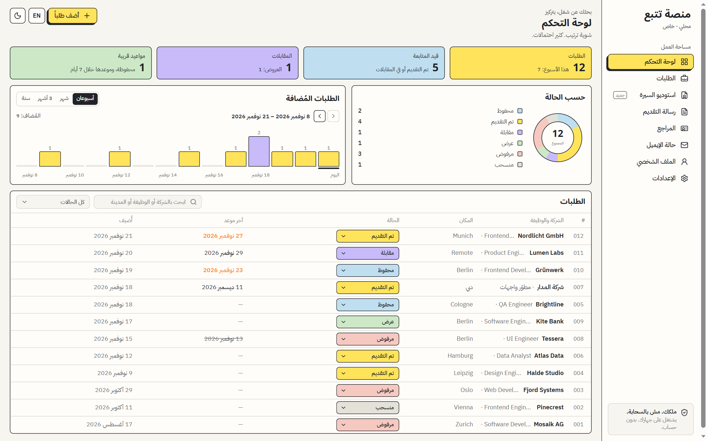<br><b>لوحة التحكم</b>: كل طلباتك وحالتها والمواعيد اللي قرّبت.</td>
    <td width="50%">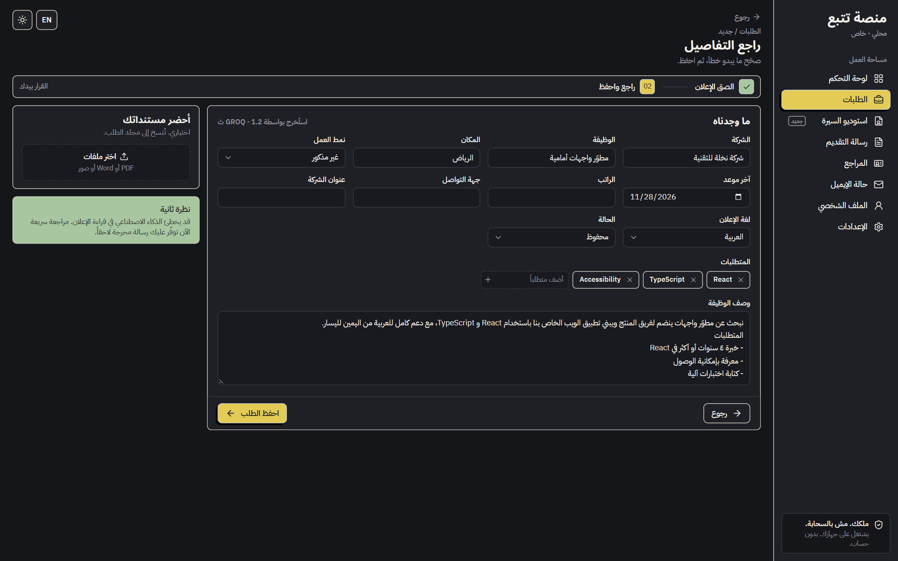<br><b>الصق إعلان الوظيفة</b>: البرنامج بيعبّي الطلب عنك.</td>
  </tr>
  <tr>
    <td>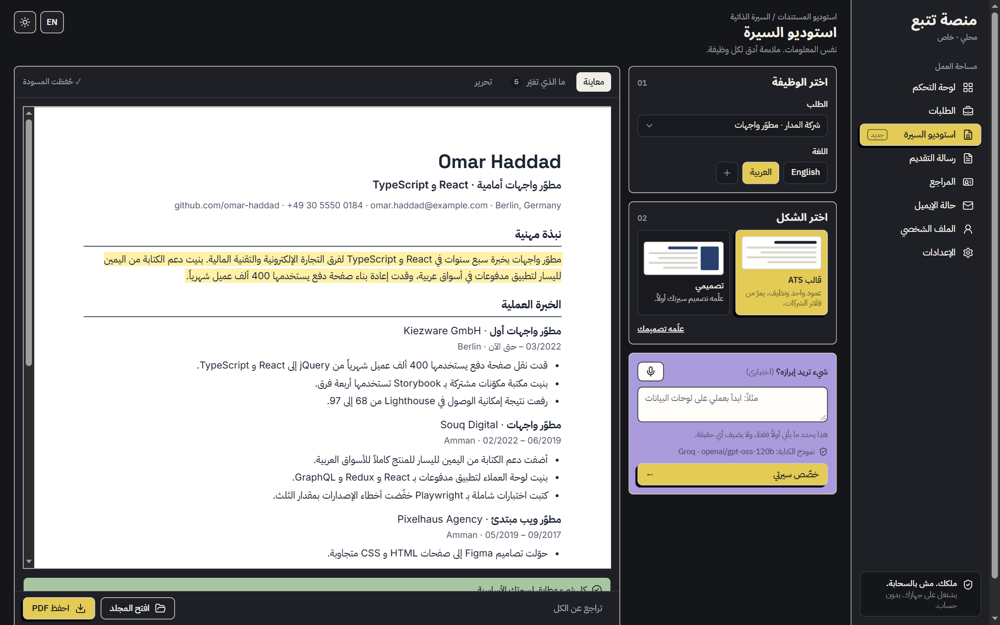<br><b>استوديو السيرة</b>: سيرة مفصّلة بقالب ATS نظيف، أو <b>بتصميمك أنت</b>، وبالعربي كمان.</td>
    <td>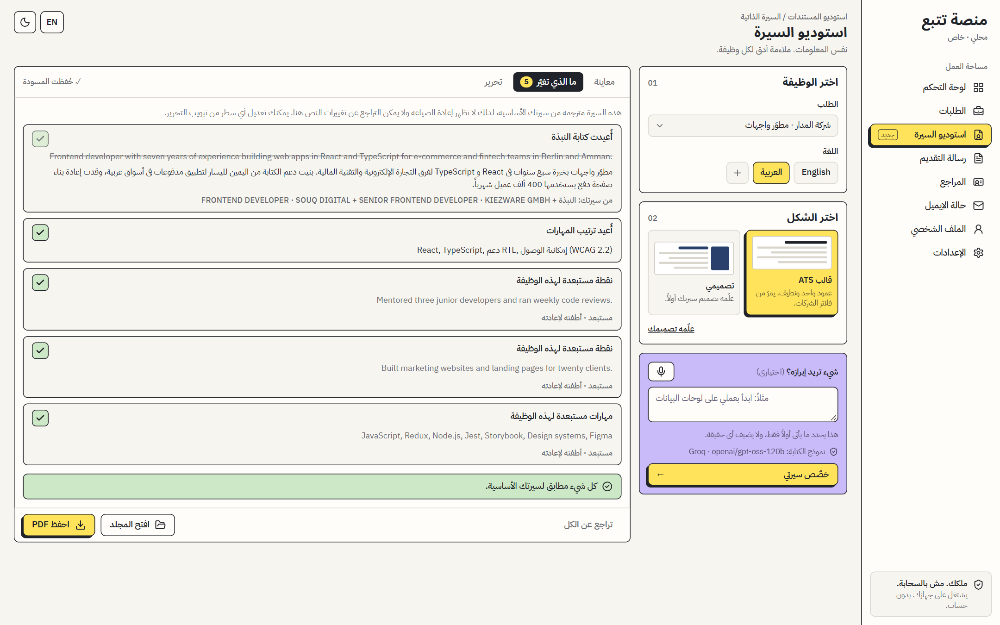<br><b>شو اللي تغيّر</b>: كل تعديل مع السطر اللي إجا منه من سيرتك. فيك ترجّع أي واحد.</td>
  </tr>
  <tr>
    <td>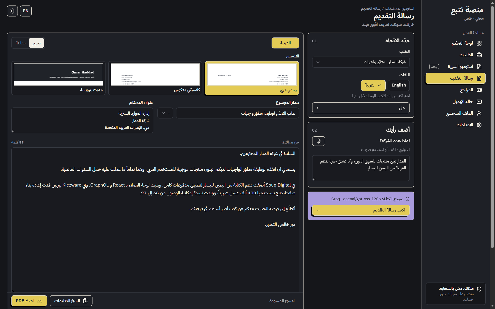<br><b>رسائل تقديم</b> بتنسيقات عربية رسمية وكلاسيكية وحديثة، ومع توقيعك.</td>
    <td>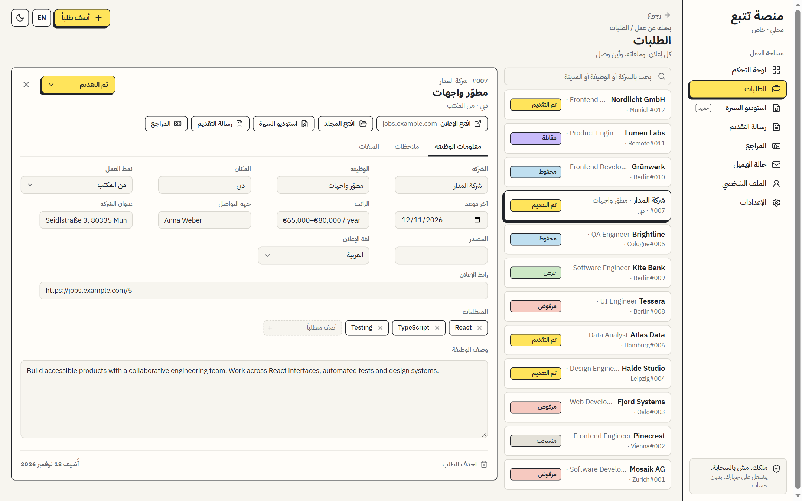<br><b>كل طلب بمكان واحد</b>: التفاصيل والملاحظات والملفات، وإله مجلد خاص باسم الشركة والوظيفة.</td>
  </tr>
  <tr>
    <td>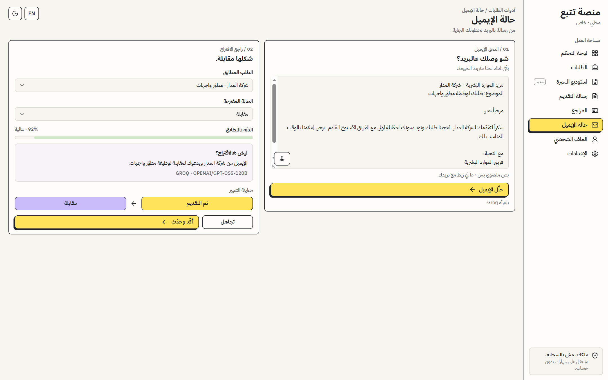<br><b>حالة الإيميل</b>: الصق رد الشركة وأكّد الحالة المقترحة.</td>
    <td>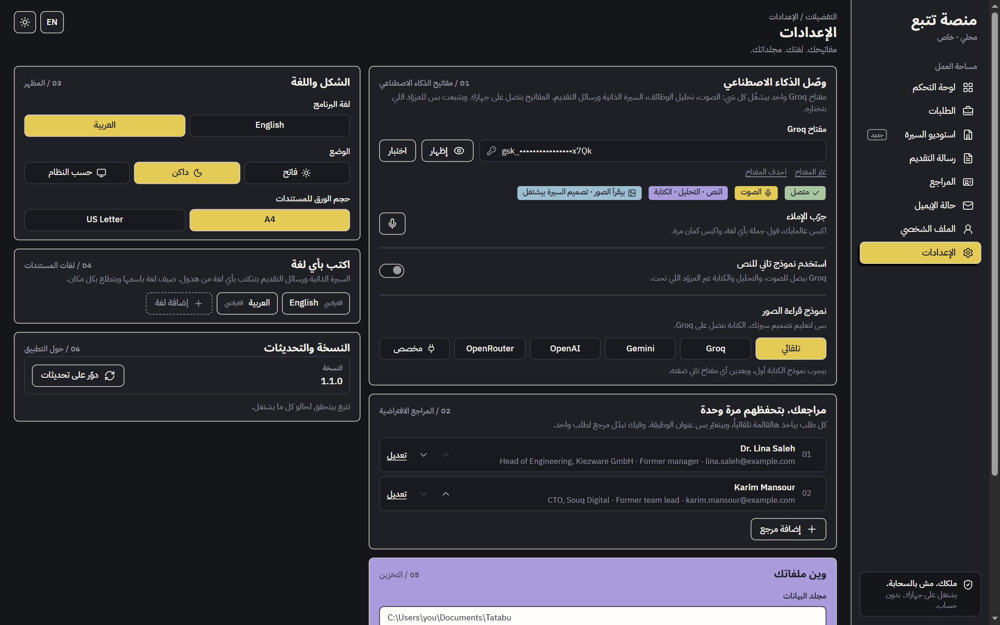<br><b>الإعدادات</b>: مفاتيح الذكاء الاصطناعي (مشفّرة)، المراجع، لغات المستندات، المظهر وحجم الورق.</td>
  </tr>
</table>

### التنزيل

نزّل آخر نسخة من [صفحة الإصدارات](https://github.com/waeltechx/Tatabu/releases/latest):

| النظام | الملف |
| --- | --- |
| ويندوز 10 أو 11 (64-bit) | `Tatabu-Setup-x.y.z.exe` |
| ماك 12 (Monterey) أو أحدث (Apple Silicon و Intel) | `Tatabu-x.y.z-mac.dmg` |

<details>
<summary><b>أول تثبيت</b> (ويندوز وماك بيطلبوا تأكيد بأول مرة)</summary>

البرنامج مجاني ومو موقّع بشهادة مدفوعة، فويندوز وماك بيطلبوا منك تأكيد بأول مرة.

**ويندوز**

1. شغّل `Tatabu-Setup-x.y.z.exe`.
2. إذا طلعتلك رسالة **"Windows protected your PC"**، اضغط **More info** وبعدين **Run anyway**.
3. كمّل التثبيت. البرنامج بيضيف اختصار على سطح المكتب وبقائمة ابدأ.

**ماك**

1. افتح `Tatabu-x.y.z-mac.dmg` واسحب **Tatabu** على **Applications**.
2. افتح Tatabu من Applications. ماك رح يقول إنه ما قدر يتحقق من البرنامج. اضغط **Done** (أو **OK**).
3. افتح **System Settings ← Privacy & Security**، انزل لتحت لعند الرسالة عن Tatabu واضغط **Open Anyway**، وأكّد بكلمة السر.
4. بعدها البرنامج بيفتح عادي. أول ما تضغط زر المايك، ماك بيسألك عن إذن المايكروفون.

</details>

<details>
<summary><b>التحديثات</b></summary>

البرنامج بيتحقق من وجود نسخة جديدة بهدوء كل ما يشتغل.

- **ويندوز:** التحديث بينزل بالخلفية. بيطلعلك شريط لما يجهز، اضغط **أعد التشغيل للتحديث** (أو بيتثبّت بس تسكّر البرنامج).
- **ماك:** بيطلعلك شريط إنه في نسخة جديدة، اضغط **نزّلها** واسحب Tatabu الجديد على Applications مكان القديم. بياناتك بتضل متل ما هي.

وفيك تتحقق بنفسك من **الإعدادات ← النسخة والتحديثات**.

</details>

<details>
<summary><b>كيف تجيب مفتاح Groq (مجاني)</b></summary>

1. روح على [console.groq.com](https://console.groq.com) وسجّل دخول (Google أو GitHub أو إيميل).
2. افتح **API Keys** واضغط **Create API Key**، وسمّيه أي اسم.
3. انسخ المفتاح. بيبلّش بـ `gsk_` وبيطلع مرة وحدة بس.
4. بالبرنامج افتح **الإعدادات ← وصّل الذكاء الاصطناعي**، الصق المفتاح واضغط **حفظ**. البرنامج بيجرّبه وبيوريك شو الميزات اللي بتشتغل فيه.

الخطة المجانية لـ Groq إلها حدود استخدام. إذا وصلت للحد، استنى دقيقة وجرّب كمان مرة، أو ضيف مزوّد تاني من الإعدادات واستخدم زر **جرّب مع …** برسالة الخطأ.

</details>

### الخصوصية

- **بياناتك بتضل على جهازك.** الطلبات والسير الذاتية والرسائل والإعدادات محفوظة بقاعدة بيانات محلية، وملفاتك بمجلد أنت بتختاره (بشكل افتراضي `Documents/Tatabu`). ما في سيرفر لتتبع ولا حساب.
- **ما في إحصائيات ولا تتبّع.** البرنامج ما بيجمع ولا بيبعت أي بيانات عن استخدامك.
- **شو بيطلع من جهازك وإيمتى:** بس لما تضغط زر بيستخدم الذكاء الاصطناعي، النص اللازم لهالمهمة (إعلان وظيفة، معلومات سيرتك، إيميل لصقته، تسجيل صوتي، أو صور صفحات سيرتك لميزة "علّمه تصميمك") بيروح للمزوّد اللي *أنت* اخترته وبمفتاحك *أنت*، وبتنطبق شروط الخصوصية تبع هالمزوّد. البرنامج ما بيغيّر المزوّد من حاله أبداً. والاتصال التاني الوحيد هو التحقق من التحديثات على GitHub.
- **المفاتيح مشفّرة** بنظام حماية جهازك (DPAPI على ويندوز، Keychain على ماك). ما بتنكتب كنص عادي، وما بتنسجّل، وما بتنحط بالنسخ الاحتياطية.
- **النسخ الاحتياطية** (الإعدادات ← نسخة احتياطية) ملف `.zip` عادي فيه بياناتك وملفاتك، و*مو* مشفّر. خليه بمكان آمن.

| | ويندوز | ماك |
| --- | --- | --- |
| قاعدة البيانات والإعدادات | `%APPDATA%\Tatabu` | `~/Library/Application Support/Tatabu` |
| ملفاتك | `Documents\Tatabu` (فيك تغيّره من الإعدادات) | `~/Documents/Tatabu` (فيك تغيّره من الإعدادات) |

إلغاء تثبيت البرنامج ما بيمسح ملفاتك ولا بياناتك. امسح هالمجلدين إذا بدك تشيل كل شي.

### حدود معروفة

- نسخة الماك بتنبنى وبتنفحص أوتوماتيك على GitHub، بس المطوّر ما عنده ماك ليجرّبها بإيده. إذا في شي ما اشتغل، [افتح issue](https://github.com/waeltechx/Tatabu/issues).
- لأن البرنامج مو موقّع بشهادة مدفوعة، ماك ما بيقدر يحدّثه أوتوماتيك: التحديث بيكون تنزيل.

### الترخيص

[MIT](LICENSE)

</div>
